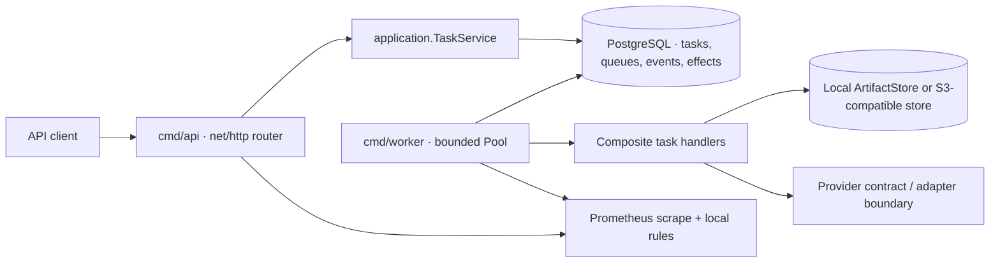

# distributed-task-lab — system overview

This page describes the repository as implemented on the Wave 4 branch. A local container smoke or a code path is not a production-readiness claim. The current gate remains `PRODUCTION_NOT_APPROVED`.

## Component map

Source entry points: [`cmd/api/main.go`](../../../cmd/api/main.go), [`cmd/worker/main.go`](../../../cmd/worker/main.go), [`internal/api/router.go`](../../../internal/api/router.go), [`internal/worker/pool.go`](../../../internal/worker/pool.go), [`internal/storage/postgres/task_repository.go`](../../../internal/storage/postgres/task_repository.go), and [`internal/artifacts/store.go`](../../../internal/artifacts/store.go).

## Durable state and ownership

PostgreSQL is the source of truth for task status, attempt, queue governance, lease owner/expiry/version, task events, effect ledger, shared admission buckets, and schema migration checksums. The API does not execute tasks. Workers lease bounded batches and write outcomes under the same owner and monotonically increasing `lease_version` fencing token. Expired leases can be reclaimed; a previous owner cannot commit success/failure with a stale generation. Retryable errors clear the lease and set database-timed `next_run_at`; terminal or exhausted work enters DLQ.

The task row and event row are updated in a transaction for enqueue/claim/completion/failure transitions. External provider calls cannot share a PostgreSQL transaction, so `effects` records durable intent and response evidence. `unknown` means the provider may have applied the effect; operators must reconcile it rather than blindly repeat it.

## API and identity boundary

The router contains legacy and `/v1` stable routes, strict payload decoding, bounded request body/time, authn/authz, request IDs, error mapping, and optional shared ingress admission. Development supports explicit API/admin tokens or configured OIDC; production requires authentication and rejects incomplete identity/provider configurations. Role checks and owner-scoped task queries are code paths, not a substitute for an external IdP, key-rotation runbook, TLS termination, or a production policy review. See [`internal/auth`](../../../internal/auth), [`internal/api/router.go`](../../../internal/api/router.go), and [`docs/wave4/WAVE4_PACKAGE_A_API_CONTRACT.md`](../WAVE4_PACKAGE_A_API_CONTRACT.md).

## Artifact and external-effect boundary

`artifacts.Store` has local and S3-compatible implementations. S3/MinIO contracts include conditional write and integrity checks; local storage is not shared across independent Worker hosts. A development Compose volume shared by local processes is not proof of cross-zone or production object-store durability. External effects are represented through `effects` and the PostgreSQL ledger; the HTTP provider is a tested contract, not a production-connected payment or notification vendor.

## Operations and trust boundaries

The repository includes digest-pinned API/Worker base images, PostgreSQL migration checks, Worker lease/heartbeat/drain behavior, Prometheus-compatible metrics, a local Prometheus/Grafana overlay, required integration/Race jobs, and local evidence scripts. The observability overlay is for development only. CI/hosted evidence applies only to the exact SHA that ran. There is no approved cloud deployment, registry signing, production secret distribution, backup operator, on-call system, or tested previous-binary rollback after migration 012.

## Deliberate non-claims

- No exactly-once execution guarantee: leases and fencing prevent stale state writes, but a handler/provider may execute more than once.
- No production SLO, throughput, latency, RPO, RTO, availability, or cost claim.
- No assertion that local storage is multi-Worker shared storage.
- No claim that an `unknown` effect can be automatically reconciled without a provider lookup contract.
- No implication that production fail-closed means production integrations are complete.
